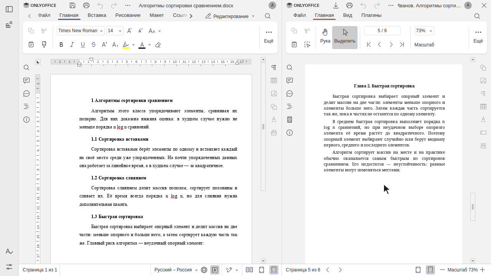
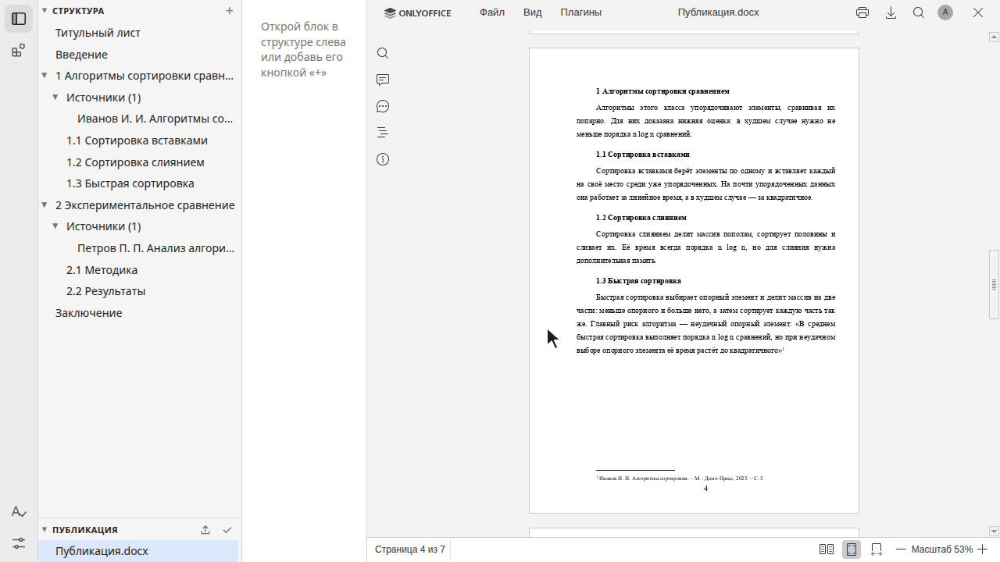
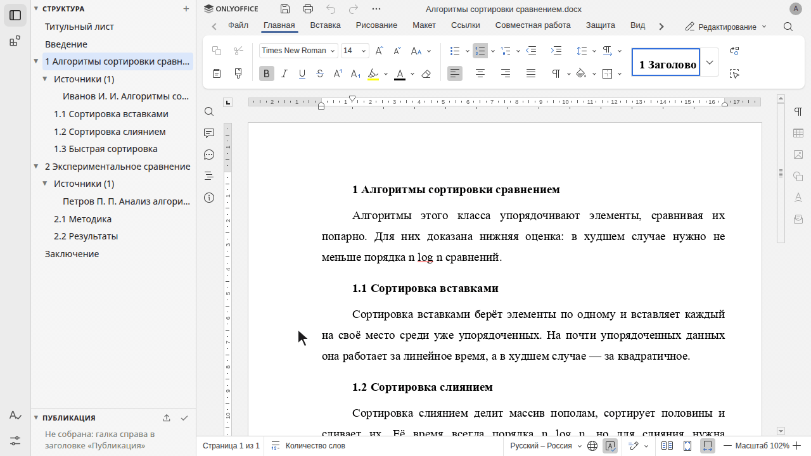

[](docs/logo.svg)

Inkwise
==========

**You write — your ghostwriter takes care of the formalities.** A smart browser editor for books, papers, reports and notes: structure, citations, styles and formatting standards are handled for you, and the whole work compiles into a single DOCX.

[](https://www.onlyoffice.com/docs)
[](https://www.python.org/)
[](https://fastapi.tiangolo.com/)
[](https://python-docx.readthedocs.io/)
[](https://pymupdf.readthedocs.io/)
[](https://docs.docker.com/compose/)

[](https://github.com/astral-sh/uv)
[](https://github.com/astral-sh/ruff)
[](https://mypy-lang.org/)
[](https://github.com/glazyrinae/Inkwise/commits/main)
[](https://github.com/glazyrinae/Inkwise)

## Features

- 🧱 **Structured writing** — a work is a tree of blocks: title page, introduction, chapters, conclusion, your own parts. Chapters and sections are numbered automatically; reorder them by drag and drop.
- ✍️ **A real word processor** — ONLYOFFICE right in the browser: tables, equations, footnotes, spell checking.
- 📚 **Citations in one click** — select a sentence in a book or web page, and it lands in your text as a quote with a properly formatted footnote, page number included.
- 📐 **Standards built in** — style presets for a scientific article, a research report and APA 7th edition; footnotes follow the citation rule chosen in the book settings.
- 🎨 **Style from a sample** — upload a PDF or Word file formatted the way you need: margins, fonts, spacing and headings become your template, missing fonts are downloaded from Google Fonts.
- 📦 **One-click compile** — title page, table of contents with page numbers, all chapters and the reference list in one DOCX.
- 🔄 **Export and import** — texts, source data and settings travel inside the compiled DOCX: send the file, import it on another computer. Library books stay as links.
- 🧩 **Plugins** — extensions panel like in VS Code.

## See it in action

The animations show the Russian interface; the same screens are available in English.

### Quote with a footnote

A book is open next to your text. Select a sentence, right-click, «Цитировать» (Quote) — the quote goes into the text, and the footnote at the bottom of the page gets the author, title, publisher, year and page.



### Style from a sample

In the extensions panel, upload a sample — for example, a journal article as a PDF. Inkwise reads the page size, margins, font, size, spacing, headings and page numbers, and the work is rebuilt in the same style.



### Compile the work

One click on the check mark in «Публикация» (Publication) — and the whole work is a single DOCX: title page, table of contents with page numbers, chapters, tables, footnotes and the reference list.



## Getting started

You need Docker with Compose and `make`. Tested on Linux (Ubuntu); on macOS and Windows use Docker Desktop (not tested there yet).

```bash
git clone https://github.com/glazyrinae/Inkwise.git
cd Inkwise
make init language=en
```

`make init` creates the `.env` settings file (it fills in the secret and file permissions itself, `language=en` gives the English interface, `language=ru` — Russian, the default), builds the app, downloads the ONLYOFFICE editor and starts everything. The first run takes a few minutes: the images are about 3.5 GB.

Open **http://localhost:8020**. On the very first start the editor needs another minute or two while ONLYOFFICE prepares its fonts — if a text doesn't open, reload the page a bit later.

## First steps

1. **«+»** next to «Structure» — add a title page, introduction, chapters and conclusion. The text of a block opens in the editor right away.
2. **Paperclip** next to a block — attach a book from your folder (PDF, DJVU, EPUB…) or a web page by its address. Inkwise looks for the citation data in the book itself — check and fix it in the form.
3. **Click the book** in the tree to open it on the right. Select a sentence → right-click → **«Quote»**.
4. **Check mark** next to «Publication» compiles the work, the **arrow** next to it downloads the DOCX.

## Good to know

- Your work lives in `deploy/book`: a block is a folder, a text is a plain `.docx`. Set another folder with `BOOK_DIR` in `.env`.
- Books for citations are taken from your home folder, read-only. Set another folder with `LIBRARY_DIR` in `.env`.
- Stop — `make compose-down`, start again — `make compose-up`, update — `git pull && make init`.
- Everything runs on your computer: ports 8020 (Inkwise) and 8021 (editor) are open to it only.
- The editor is [ONLYOFFICE Docs](https://github.com/ONLYOFFICE/DocumentServer) Community Edition (AGPL v3); its image is pulled from Docker Hub.

## For developers

How everything works — [CLAUDE.md](CLAUDE.md) (in Russian), how to write plugins — [PLUGINS.md](PLUGINS.md).
